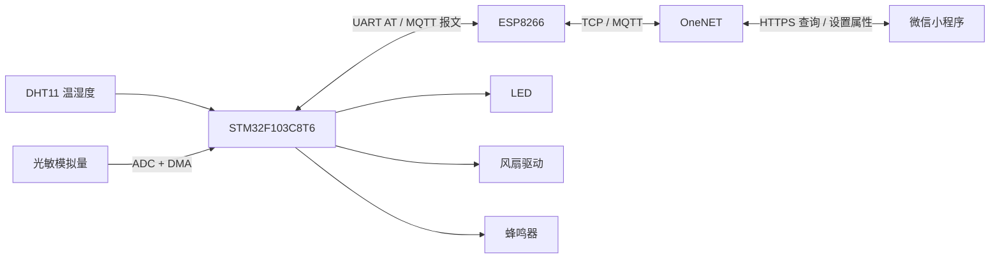

# STM32 + ESP8266 智能家居环境监测系统

基于 **STM32F103C8T6、ESP8266、OneNET 和微信小程序** 的环境监测与远程控制项目。设备采集温湿度、相对光照，通过 MQTT 上报云平台；微信小程序通过 HTTPS 查看数据并设置设备属性，实现 LED 开关、风扇三档 PWM 调速及报警使能控制。

本仓库包含可配置的 STM32 固件工程与微信小程序源码。固件使用 **STM32 HAL + 裸机主循环**，MQTT 报文由 STM32 组装，ESP8266 的 AT 固件负责 Wi-Fi / TCP 接入。

## 功能概览

| 功能 | 实现方式 |
|---|---|
| 温湿度采集 | DHT11 软件单总线通信、40 位数据读取与校验 |
| 光敏采集 | TIM3 触发 ADC1，DMA 循环搬运，换算为相对百分比 |
| 属性上报 | 温度 `W`、湿度 `S`、相对光照 `G`，标称约 4 秒一次 |
| 数据展示 | 小程序环境数值卡片，标称 5 秒轮询 OneNET 最新属性 |
| LED 控制 | 小程序设置布尔属性 `L`，设备控制 GPIO |
| 风扇调速 | 属性 `F` 取 0 / 1 / 2 / 3，分别为停止 / 三个 PWM 档位 |
| 环境报警 | 属性 `B` 控制报警使能，本地阈值判断是否鸣叫 |

> 光照为未经 lux 标定的相对值。风扇采用开环 PWM 调速，不包含转速测量或闭环控制。采样、上传和页面刷新周期彼此独立。

## 系统架构



**数据上行**：传感器 → STM32 → JSON / MQTT PUBLISH → ESP8266 → OneNET → 小程序 HTTPS 查询。

**控制下行**：小程序 HTTPS 设置属性 → OneNET → MQTT 属性设置主题 → STM32 JSON 解析 → 执行器。

## 目录结构

```text
.
├── firmware/
│   ├── Core/                   # CubeMX 生成的主程序、外设配置和中断
│   ├── Drivers/                # STM32 HAL / CMSIS
│   ├── USER/                   # DHT11、光敏、LED、风扇、蜂鸣器、OLED
│   │   ├── app_config.h        # 本地配置入口
│   │   └── app_config.local.example.h
│   ├── WIFI/                   # ESP8266、OneNET、MqttKit、cJSON
│   ├── MDK-ARM/                # Keil 工程和启动文件
│   └── wulianwang.ioc          # CubeMX 工程
├── miniprogram/
│   ├── pages/index/            # 环境数据显示页面
│   ├── pages/my/               # LED、风扇、报警控制页面
│   ├── image/                  # 页面图标
│   ├── config.js               # OneNET 配置与 API 地址构造
│   └── config.local.example.js
├── docs/
│   ├── setup.md                # 硬件、云平台与部署配置
│   ├── protocol.md             # 属性、主题与控制含义
│   ├── limitations.md          # 当前边界与后续方向
│   └── validation.md           # 本次整理的验证记录
├── scripts/check_repository.py # 发布文件、引用与敏感配置检查
└── THIRD_PARTY_NOTICES.md       # 第三方代码说明
```

## 硬件与引脚

| 模块 / 信号 | STM32 引脚 | 说明 |
|---|---|---|
| DHT11 DATA | PA6 | 单总线，按实际模块确认上拉与供电 |
| 光敏模拟量 | PA0 / ADC1_IN0 | 模拟电压须在 ADC 输入允许范围内 |
| ESP8266 UART | PA2 TX、PA3 RX | USART2，115200，8N1，TX/RX 交叉连接 |
| 调试串口 | PB6 TX、PB7 RX | USART1 重映射，115200，8N1 |
| 风扇 PWM | PA10 / TIM1_CH3 | 1 kHz，连接驱动模块而非直接驱动电机 |
| 风扇方向 | PB10、PB11 | 停机模式需结合实际驱动芯片真值表确认 |
| LED | PA12 | 当前代码为低电平有效 |
| 蜂鸣器控制 | PA15 | 当前代码为低电平有效 |
| OLED 软件信号 | PB14、PB15 | 工程保留驱动；当前未实现主循环环境数据刷新 |

ESP8266 使用稳定的 3.3 V 供电，各模块共地。具体电机驱动型号、光敏电路和板级供电应以实物为准，仓库未附原理图与 PCB 文件。

## 快速开始

### 1. 获取源码

```bash
git clone https://github.com/lhssssss-nnn/smart-home-stm32-onenet.git
cd smart-home-stm32-onenet
```

### 2. 创建本地配置

在仓库根目录运行以下 PowerShell 命令：

```powershell
Copy-Item firmware/USER/app_config.local.example.h firmware/USER/app_config.local.h
Copy-Item miniprogram/config.local.example.js miniprogram/config.local.js
```

按注释填写自己的 Wi-Fi、OneNET 产品标识、设备名及授权信息。固件与小程序必须指向同一个设备。

两个 `*.local.*` 配置由 Git 忽略，**不要提交真实密码或访问凭据**。设备 MQTT 凭据与小程序 API 授权用途不同，应分别按平台权限配置。完整步骤见 [配置指南](docs/setup.md)。

### 3. 编译与烧录固件

1. 安装 Keil MDK-ARM、STM32F1 设备包与对应调试器驱动。
2. 打开 [`firmware/MDK-ARM/wulianwang.uvprojx`](firmware/MDK-ARM/wulianwang.uvprojx)。
3. 工程目标为 `wulianwang`，原工具链为 **ARM Compiler 5.06 update 6**，原设备包为 `Keil.STM32F1xx_DFP 2.1.0`。
4. 填好本地配置后执行 Build / Rebuild，通过 SWD 烧录到目标开发板。
5. 使用调试串口观察 AT 联网、TCP 连接、MQTT 登录和订阅结果。

本仓库未迁移到 ARM Compiler 6 或 GCC，切换编译器时需单独验证。配置头通过现有 `USER` 包含目录引入，不需要把密码写回业务代码。

### 4. 配置与运行微信小程序

1. 使用微信开发者工具导入 `miniprogram/`。
2. 将 `project.config.json` 中的 `touristappid` 替换为自己的小程序 AppID。
3. 填写 `config.local.js`，确认与设备端产品、设备名一致。
4. 按微信平台要求配置 `https://iot-api.heclouds.com` 请求域名。
5. 设备在线并正常上报后，查看首页的温度、湿度、相对光照，进入控制页操作 LED、风扇和报警开关。

小程序通过 HTTPS API 访问平台，没有使用 MQTT over WebSocket。当前控制成功提示与设备执行确认尚未完整关联，详见[当前边界](docs/limitations.md)。

## OneNET 物模型

| 标识 | 类型 | 方向 | 含义 |
|---|---|---|---|
| `W` | 整数 | 上报 | 温度整数，℃ |
| `S` | 整数 | 上报 | 湿度整数，%RH |
| `G` | 整数 | 上报 | 相对光照，% |
| `L` | 布尔 | 下发 | LED 开关 |
| `B` | 布尔 | 下发 | 本地阈值报警使能 |
| `F` | 整数 / 枚举 0—3 | 下发 | 风扇停止 / 1 档 / 2 档 / 3 档 |

上报与下发主题、JSON 示例和控制逻辑见 [协议说明](docs/protocol.md)。

## 关键设计

- **定时器触发 ADC + DMA**：光敏输入按硬件时基采样，主循环读取最近结果。
- **采集与上报分开**：TIM3 提供周期事件，中断仅设置计数 / 标志，主循环处理业务和网络。
- **设备 MQTT、应用 HTTPS**：通过 OneNET 物模型统一设备与小程序的字段。
- **本地报警判断**：云端控制是否使能，温度 / 湿度 / 光敏超阈值时由设备侧决定蜂鸣器输出。
- **私有配置与源码分离**：配置示例可公开，真实配置留在本地，编译产物和个人 IDE 文件不纳入版本管理。

## 验证与当前边界

整理后的检查范围和结果见 [验证记录](docs/validation.md)。本次仓库整理不代表重新完成实物、云端或真机小程序验证。

当前保留原有采集和控制业务流程。后续重点包括完整串口报文解析、DHT11 合理采样周期、异常 JSON 处理、分层重连，以及设备执行回复与前端状态确认。详见 [limitations.md](docs/limitations.md)。

## 第三方代码

工程使用 STM32 HAL / CMSIS、MqttKit 与 cJSON，保留原有文件声明和作者信息，见 [第三方说明](THIRD_PARTY_NOTICES.md)。本仓库未给全部代码和素材追加统一许可证；使用和再分发时应遵守各部分原授权。
